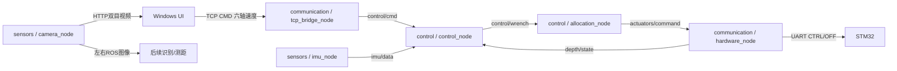

# uw_ws：按控制、传感器、通信组织的ROS2工程

工程包含 **3个业务包＋2个支撑包**。包用于组织职责，节点仍按独立运行任务划分。

| 包 | 节点/内容 | 边界 |
|---|---|---|
| `uw_robot_control` | `control_node`、`allocation_node` | 从输入和状态得到目标力矩，再分配推进器与舵角；不打开串口、TCP或摄像头 |
| `uw_robot_sensors` | `imu_node`、`camera_node` | 读取IMU和OpenCV双目，提供带时间信息的传感器数据及HTTP预览 |
| `uw_robot_communication` | `tcp_bridge_node`、`hardware_node` | 手柄TCP、STM32串口、协议转换和通信超时；不做姿态PID或推力分配 |
| `uw_robot_interfaces` | 消息和共用数据类型 | 只定义接口，不实现算法和驱动 |
| `uw_robot_bringup` | launch、robot.yaml | 统一装配节点和参数，不实现业务逻辑 |

先读 [直接运行](docs/直接运行.md)，再读 [结构和接口](docs/结构和接口.md)。
相机细节见 [OpenCV双目相机](docs/OpenCV双目相机.md)。

此次只调整包、目录、依赖、工具和文档；控制参数、算法公式、话题名、节点名、可执行文件名和STM32协议保持原样。
旧8包源码及构建产物移到 `~/uw_ws_backups/before_business_grouping_*`，避免旧install残留让系统继续找到已合并的包。
历史说明保存在 `docs/history/before_package_grouping/`，不是当前启动指南。

已有的UI遥测字段不完整、WSL跨进程图像DDS异常、香橙派算力和水下闭环稳定性仍需分别验收；合包不会自动解决这些问题。

## 指令接口

手柄轴映射、死区、滤波和量程换算都在**发送端**完成，发送端直接下发机体系六轴速度：

- TCP 帧：`CMD:u,v,w,p,q,r,arm,estop,depth,loop\n`（10 个字段）。
- ROS 话题：`control/cmd`，消息 `uw_robot_interfaces/ControlCommand`。
- 满杆量程：`u = v = w = 1.0`、`p/q/r = 25/25/25 °/s`（三个线轴同一标尺）。
- 满杆推力：`u = 30 N`、`v = 10 N`、`w = 10 N`，故 `damping = 30/10/10 N/(m/s)`；
  定深目标变化率由 `depth_change_mps = 0.25` 单独给出（同参考实现）。
- 注意：闭环平移增益是手感调校值，不再等于参考实现的 `MAX_BODY_FORCE(20/6/10)`；姿态与角速度环仍与参考实现逐项一致。
- 控制节点只做六轴速度跟踪、解锁/急停/超时仲裁和最终限幅，不再解析摇杆轴。

## MuJoCo仿真后端

新增第6个包`uw_robot_mujoco`，替代实物串口和IMU接入同一套ROS控制链。见[MuJoCo仿真](docs/MuJoCo仿真.md)。原3业务包＋2支撑包结构保持，仿真包作为可选后端。

实物迁移：当前以 docs/实物迁移与标定.md 为准；两种后端共用 robot.yaml，模拟对象参数位于 plant.yaml。
