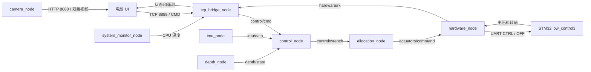

# uw_ws · 水下机器人控制工程

一套覆盖 **电脑操作界面、Jetson Orin ROS 2 控制、STM32 执行层和 MuJoCo 仿真** 的水下机器人工程。当前实物采用 IMU、MS5837 深度计和双目相机直连 Orin，STM32 负责执行器、电压和电调转速。

- **电脑**：读取手柄，发送控制指令，显示双目画面、状态和遥测。
- **Orin**：采集传感器，执行控制与推力分配，通过串口下发最终执行量。
- **STM32**：输出四路推进器与三路舵机 PWM，采集电压和四路转速，执行底层停机保护。
- **MuJoCo**：替代真实被控对象，复用 ROS 控制链；不与实物控制入口同时运行。

> 首次带动力测试前，先断开推进器动力，验证中位、方向、急停、断链和故障恢复。软件测试通过不等于实物控制或水下闭环已完成验收。

## 1. 系统结构



深度计默认由 Orin I2C 直接采集，STM32 不再转发深度。相机由一个 `camera_node` 独占采集，HTTP 预览和 ROS 图像发布共享同一份采集结果。

### ROS 包与节点

| 包 | 节点或内容 | 职责 |
|---|---|---|
| `uw_robot_control` | `control_node`、`allocation_node` | 控制状态机、姿态/定深控制、推力与舵角分配 |
| `uw_robot_sensors` | `imu_node`、`depth_node`、`camera_node`、`system_monitor_node` | IMU、I2C 深度、双目图像、Orin CPU 温度 |
| `uw_robot_communication` | `tcp_bridge_node`、`hardware_node` | 电脑 TCP 接入、STM32 串口、协议转换与通信保护 |
| `uw_robot_interfaces` | 消息、共享类型 | ROS 接口与单位约定 |
| `uw_robot_bringup` | launch、YAML | 实物/仿真装配与参数配置 |
| `uw_robot_mujoco` | `mujoco_node` | 仿真对象、模拟传感器与合成双目 |
| `uw-hello` | 既有示例 | 非实物控制链必需包 |

## 2. 仓库目录

```text
uw_ws/
├── src/                              ROS 实物与仿真包
├── operator_ui/Joystick_Over_Ethernet/ 电脑端 UI
├── firmware/low_control3/             STM32F407 下位机
├── scripts/                          依赖检查、部署自检、构建测试
├── tools/                            离线联调、控制一致性与仿真验证
│   └── YbImuLib/                     IMU SDK 源码
├── docs/                             部署、接口、标定与验收说明
├── reference/                        参考控制实现
├── migration/                        迁移和源码同步记录
└── validation/                       验证结果与报告
```

`firmware/`、`operator_ui/` 和 `tools/YbImuLib/` 设有 `COLCON_IGNORE`，不会混入 ROS 构建。`migration/` 与 `validation/` 不参与机器人运行，用于追溯代码来源和验证结果。

后续建议在本仓库内维护三端代码。若继续修改仓库外的旧 UI、固件或 `uw_ws_orin`，需要同步回本仓库后再提交。`build/`、`install/`、`log/`、旧压缩包和 MCU 烧录产物均由 `.gitignore` 排除。

## 3. 当前实物配置

以下是当前已确认的接入配置，不适用于所有载板。设备或安装方式改变后，应重新核对。

| 设备/连接 | 当前配置 | 主要参数位置 |
|---|---|---|
| Orin 系统 | Ubuntu 22.04 / ROS 2 Humble / Python 3 | ROS 使用系统 Python 环境 |
| 电脑 ↔ Orin | 网线；当前 UI 默认 Orin IP 为 `192.168.1.10` | UI `config.py` |
| 控制/遥测 TCP | `8888` | `tcp_bridge_node` 参数 |
| STM32 串口 | `/dev/ttyTHS2`，115200、8N1 | `hardware_node` 参数 |
| USB IMU | `/dev/ttyCH341USB0`，目标约 100Hz | `imu_node` 参数 |
| MS5837-30BA | I2C-7，七位地址 `0x76`，`model: 30ba`，目标 20Hz | `depth_node` 参数 |
| 原双目相机 | `/dev/video0`，左右拼接 `2560×720`，请求 30FPS | `camera_node` 参数 |
| 双目视频 | `http://<Orin-IP>:8080/stereo.mjpg` | 相机 HTTP 服务 / UI 配置 |
| CPU 温度 | 自动识别 CPU 热区，默认 1Hz | `system_monitor_node` 参数 |

ROS 共享参数文件：[robot.yaml](src/uw_robot_bringup/config/robot.yaml)。控制增益、推力几何及设备参数以这个文件为准，首页不重复列出全部调参值。

**深度计扫描注意事项：** 当前 MS5837 曾在 `i2cdetect -r` 中不显示地址，但复位、PROM 读取和 ROS 节点均能正常工作。不能只凭扫描结果判定设备损坏；按手册进行实际读写验证，见 [MS5837 直连说明](docs/MS5837直连Orin.md)。自动零点标定应在空气中静止完成，不能把水下位置当作水面零点。

## 4. Orin：环境、编译与启动

以下命令假设仓库位于 `~/uw_ws`，且已安装 ROS 2 Humble。不要从 Windows 或另一台机器复制旧 `build/install/log`。

### 4.1 检查环境

```bash
cd ~/uw_ws
python3 scripts/verify_tree.py
bash scripts/install_deps.sh --check-only
```

首次部署、确实缺少依赖时，再使用 `bash scripts/install_deps.sh` 安装依赖。该脚本会安装所需软件和配置设备用户组，不执行 `apt upgrade`；正常更新源码不需要反复安装依赖，也不需要升级系统或内核。

IMU SDK 需单独安装到 ROS 所使用的 Python 环境，例如：

```bash
python3 -m pip install --user ./tools/YbImuLib
```

用户需具有 `dialout`、`i2c`、`video` 对应设备访问权限；加入用户组后重新登录。CH340 驱动属于系统环境，复制工作空间不会自动安装驱动。详细步骤见 [Orin 部署](docs/Orin部署.md)。

### 4.2 编译并测试

```bash
cd ~/uw_ws
bash scripts/check.sh
source install/setup.bash
```

`check.sh` 内部调用 `colcon build` 并运行测试，不必再重复编译。只编译、不跑测试可用 `bash scripts/check.sh --build-only`。每个新终端都需要加载 `~/uw_ws/install/setup.bash`。

### 4.3 选择一种启动方式

**无实物设备调试：** 不打开 MCU 串口，不启动 IMU、深度计或相机。

```bash
ros2 launch uw_robot_bringup robot.launch.py \
  dry_run:=true imu:=false depth_source:=none camera:=false
```

**传感器联调：** 启动真实传感器，保持 MCU 串口关闭。此模式看不到 MCU 的真实电压/转速。

```bash
ros2 launch uw_robot_bringup robot.launch.py \
  dry_run:=true imu:=true depth_source:=i2c camera:=true
```

**整机实物：** 启用真实 MCU 串口及执行器通信。首次验收先断开推进器动力。

```bash
ros2 launch uw_robot_bringup robot.launch.py \
  dry_run:=false imu:=true depth_source:=i2c camera:=true
```

常用开关：

| 参数 | 默认值 | 说明 |
|---|---|---|
| `dry_run` | `true` | 为 true 时不打开 STM32 串口 |
| `imu` | `false` | 是否启动 IMU |
| `depth_source` | `i2c` | `i2c` 直连深度；`none` 关闭；`stm32` 仅兼容旧深度转发方案 |
| `camera` | `false` | 是否启动双目相机 |
| `monitor` | `true` | 是否启动 CPU 温度监测 |
| `tcp` | `true` | 是否启动电脑控制/遥测桥 |
| `config` | 已安装的 `robot.yaml` | 可指定另一份完整参数文件 |

不要同时启动整组和第二个独立传感器/串口节点。当前 `low_control3` 不上报深度，实物使用 `depth_source:=i2c`。

### 4.4 单独测试节点

```bash
# 深度计：使用已配置的 I2C-7 / 30ba
ros2 launch uw_robot_bringup depth.launch.py

# 原双目相机
ros2 launch uw_robot_bringup camera.launch.py

# Orin CPU 温度
ros2 run uw_robot_sensors system_monitor_node

# IMU
ros2 run uw_robot_sensors imu_node --ros-args \
  --params-file ~/uw_ws/src/uw_robot_bringup/config/robot.yaml
```

这些命令按需选择，不要与整组入口重复运行。相机 HTTP 还提供 `/health`、`/snapshot.jpg`、`/left.jpg`、`/right.jpg`；`/?action=stream` 保留为整幅双目流的兼容入口。

## 5. 电脑端 UI

在 Windows 上进入仓库内的 UI 目录，使用已安装 `pygame`、`opencv-python`、`numpy` 的 Python 环境：

```powershell
cd E:\uw-robot\uw_ws\operator_ui\Joystick_Over_Ethernet
python main.py
```

启动前确认 [config.py](operator_ui/Joystick_Over_Ethernet/config.py) 中 `ONBOARD_IP` 是当前 Orin 地址。命令端口为 8888，双目流为 HTTP 8080；换回原相机后，不再使用临时 `1280×720` 覆盖参数。UI 会自动缩放拼接画面，左右目顺序通过遮挡镜头核验。

| 操作 | 当前作用 |
|---|---|
| 左摇杆 | 前后、横移 |
| 左右扳机 | 升沉 |
| 右摇杆 | 俯仰、偏航 |
| LB / RB | 横滚 |
| A | 解锁/锁定切换 |
| B | 急停 |
| X | 定深切换 |
| Y | 开环/闭环切换，是否允许由 Orin 状态机决定 |

实际解锁、定深、控制模式以 Orin 回传状态为准；按钮松开后的输入 false 不代表模式自动关闭。

UI 明确显示 **Orin CPU 温度**。电压、转速、温度等缺失、无效或过期时显示 `--`；真实零转速显示 `0`。控制连接由 `ARMED` 状态心跳判断在线，视频或其它遥测不能代替控制心跳。视频超过 2秒未更新会隐藏旧画面；当前视频线程不自动重连，相机恢复后可重启 UI。

详见 [UI 说明](operator_ui/Joystick_Over_Ethernet/README.md)。

## 6. STM32 下位机

源码位于 [firmware/low_control3](firmware/low_control3)。使用 VS Code 时单独打开该目录，使它的 `${workspaceFolder}` 指向固件工程。

```powershell
cd E:\uw-robot\uw_ws\firmware\low_control3
.\scripts\build.ps1 -Configuration Release
```

需要 STM32 GNU 工具链、CMake、Ninja；运行本机测试还需要主机 C++ 编译器。产物位于 `build/Release/low_control3.{elf,hex,bin}`。脚本只构建和测试，不自动烧录；VS Code 的 OpenOCD/GDB 路径和烧录器接口需匹配本机实际环境。

当前行为：

- 上电推进器/舵机 PWM 中位为 1500μs，绿灯与两声提示音；位置舵机可能移动到中位。
- `OFF`、控制超时、接收故障或异常命令会回中；上电和故障恢复后，先收到四路零推力 CTRL 才允许继续运动。零推力帧仍可能执行舵机/夹爪指令。
- 控制超时阈值 200ms，另有 SysTick 停机路径和独立 IWDG；实际停机延迟包含 PWM 周期及电调响应，必须实测。
- 电调反馈滑动重同步，连续两帧 CRC 正确后有效，500ms 无新有效帧失效。极对数暂沿用原值 7，需按实际电机核对。
- 常规电压和四路转速 10Hz 上报，诊断另以 1Hz `DIAG` 行发送。无效值为 `--`。

详见 [固件说明](firmware/low_control3/README.md)、[协议与保护行为](firmware/low_control3/docs/协议与安全行为.md)、[上机验收](firmware/low_control3/docs/上机验收.md)。

## 7. 常用话题与检查命令

```bash
source ~/uw_ws/install/setup.bash
ros2 node list
ros2 topic list -t
ros2 topic echo /hardware/tx --full-length
ros2 topic echo /hardware/rx --full-length
ros2 topic echo /robot/status
ros2 topic hz /imu/data
ros2 topic hz /depth/state
```

| 话题 | 内容 |
|---|---|
| `/control/cmd` | 电脑输入的六轴速度与按钮命令 |
| `/control/wrench` | 控制器目标力与力矩，不是实测推力 |
| `/actuators/command` | 分配后的推进器推力、舵角及夹爪状态 |
| `/allocation/status` | 分配状态与可实现输出诊断 |
| `/robot/status` | 实际解锁、闭环、定深与传感器健康状态 |
| `/imu/data` | 姿态四元数、角速度、加速度 |
| `/depth/state` | 深度、变化率、有效性及数据年龄 |
| `/system/cpu_temperature` | Orin CPU 摄氏温度 |
| `/hardware/tx` | 拟发送/实际交给串口链路的 CTRL 或 OFF 文本 |
| `/hardware/rx` | STM32 原始混合遥测与 DIAG 行 |
| `/camera/left/image_raw` | 左目原始图像，有订阅时发布 |
| `/camera/right/image_raw` | 右目原始图像，有订阅时发布 |

IMU、深度和相机的配置频率是目标值，实际频率需用 `ros2 topic hz` 测量。CPU 监测或相机退出不触发整组控制链关闭；实物入口中的必需节点退出会联动停止整组。

## 8. 协议与单位

| 链路 | 数据 |
|---|---|
| 电脑 → Orin TCP | `CMD:u,v,w,p,q,r,arm,estop,depth,loop\n`，约 30Hz |
| Orin → STM32 UART | `CTRL:f1,f2,f3,f4,s1,s2,gripper\n` 或 `OFF\n` |
| STM32 → Orin UART | `VOLT:15.23 CH0:1200 CH1:0 CH2:-- CH3:--`，另有低频 DIAG |
| Orin → 电脑 TCP | 状态与独立键值行：CPU_TEMP、VOLT、CH0～CH3、深度、姿态及有效标记 |

机体系线速度按接口约定：**X 前、Y 左、Z 上**，单位 m/s；角速度单位 rad/s。深度与定深目标另采用**向下为正**，不要与机体系 Z 速度混淆。坐标和离散命令定义见 [ControlCommand.msg](src/uw_robot_interfaces/msg/ControlCommand.msg)。

手柄映射、死区和指令整形在电脑端 `command_mapper.py`；Orin 做控制仲裁、控制律和推力分配。`arm`、`depth_toggle`、`loop_toggle` 是输入事件，模式持续状态应看 `/robot/status`。

CPU_TEMP 来源是 Orin sysfs CPU 热区，不是 STM32 芯片温度或水温；TEMP 仅是 CPU_TEMP 的兼容别名。TCP 桥默认约 1Hz 转发温度、电压和转速，不能用 MCU 10Hz 上报频率推断电脑刷新频率。MCU 诊断可在 `/hardware/rx` 查看，当前不会全部显示在电脑 UI。

## 9. MuJoCo 仿真

使用与 ROS 对应的 Python 环境，并准备 MuJoCo、NumPy 和所需图形依赖。默认无交互窗口；合成双目渲染仍需要可用的图形后端，不应将 `headless` 理解为完全不需要图形能力。

```bash
source ~/uw_ws/install/setup.bash

# 只运行物理与控制链，关闭相机，适合基础无窗口测试
ros2 launch uw_robot_bringup simulation.launch.py headless:=true camera:=false

# 有相应桌面/OpenGL 环境时，打开交互窗口和合成双目
ros2 launch uw_robot_bringup simulation.launch.py headless:=false camera:=true
```

仿真入口不启动真实 `hardware_node` 或真实传感器。不要与实物入口同时启动，以免争用话题、TCP 8888 或 HTTP 8080。

控制与分配参数共用 `robot.yaml`，仿真对象读取 [plant.yaml](src/uw_robot_bringup/config/plant.yaml)；仿真 launch 的 `moment_sign` 覆盖只适配后端坐标约定。模型参数并非全部经过实物标定，详见 [MuJoCo 仿真](docs/MuJoCo仿真.md)。

## 10. 测试与当前验证范围

| 检查 | 命令/入口 |
|---|---|
| ROS 文件、语法、YAML 自检 | `python3 scripts/verify_tree.py` |
| ROS 构建与单元测试 | `bash scripts/check.sh` |
| 控制参考一致性检查 | `bash tools/check.sh`，额外执行 parity 工具 |
| 假 sysfs + 伪串口 → 实际 ROS 节点 → TCP | `python3 tools/telemetry_smoke.py`，需先构建并加载环境 |
| UI 有效性、过期及网络接收测试 | 在 UI 目录执行 `python -m unittest discover -s tests -v` |
| 固件协议与假 HAL 故障测试 | 固件 `scripts/build.ps1` 或其 `tests/` CMake 工程 |

2026-11-25 同步时，7 个 ROS 包构建、73 项 ROS 测试、12 项 UI 测试、5 组固件本机测试、Release 交叉编译和伪设备遥测端到端验证通过。结果见 [同步验证记录](validation/sync_20261125.json)。这些记录有明确的测试环境和范围，不代表真实水下系统已经验收。

**当前待验证/排查：**

- 实物曾出现 `CH_READY:0`、`SPI_ERRORS` 增长及 `STOP_REASON:8` 接收故障；精简遥测没有修复这些问题，应继续对照 `DIAG` 排查。
- 推进器通道/方向、实际极对数、电压标定、中位、断链、重启及看门狗停机时间仍需逐项实测。
- 原相机左右目安装顺序、标定与实际帧率需现场核验；深度有效输出不等于水下精度或定深闭环方向已验证。
- 下行 CTRL 文本仍无校验和、序号与独立解锁位；下一版协议升级需同时修改 Orin 和 STM32。

## 11. 文档与提交

| 文档 | 内容 |
|---|---|
| [Orin 部署](docs/Orin部署.md) | 实物配置、部署与新增遥测 |
| [MS5837 直连](docs/MS5837直连Orin.md) | I2C 实际读写、型号、零点与深度验收 |
| [OpenCV 双目](docs/OpenCV双目相机.md) | 相机采集、图像与 HTTP 服务 |
| [结构和接口](docs/结构和接口.md) | 工程模块及 ROS 接口说明 |
| [实物迁移与标定](docs/实物迁移与标定.md) | 参数迁移、实测标定与控制核验 |
| [同步与提交说明](docs/实物同步与提交说明.md) | 三端源码同步范围与验证边界 |

`docs/history/` 保存历史方案，不能替代本页和当前源码中的启动方式。迁移记录、测试报告可随源码提交；临时日志、重复归档和构建产物不提交。

在仓库根目录检查并提交自己的修改：

```powershell
git status --short
git diff -- README.md
git add README.md
git commit -m "docs: clarify setup, architecture and hardware testing"
git push origin main
```

以上只提交本次 README 修改；若还有其它待提交源码，应另行检查并选择加入。不要强制添加 `.gitignore` 已排除的旧压缩包、驱动构建目录或烧录产物。
