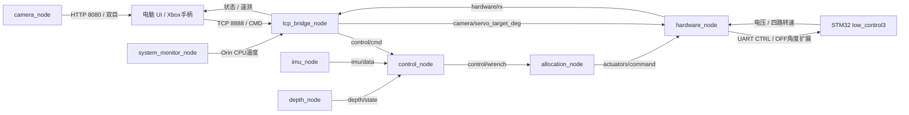

# uw_ws · 水下机器人控制工程

本仓库收录电脑操作界面、Jetson Orin ROS 2、STM32 执行层和 MuJoCo 仿真。当前实物由 Orin 直连 IMU、MS5837 深度计与双目相机；STM32 输出四路推进器、两路转向舵机和一路摄像头舵机 PWM，并采集电池电压与四路电调转速。

**源码同步核对：2026-11-27。** 已包含实测 low2 的 SPI/初始化修复、新 low3、摄像头十字键控制、可选下水日志及 VS Code 烧录运行任务。当前第七路为摄像头，原夹爪控制已废止。

## 1. 系统与目录



```text
uw_ws/
├── src/                               ROS实物、日志与仿真包
├── operator_ui/Joystick_Over_Ethernet/  电脑UI及手柄映射
├── firmware/low_control3/              STM32F407源码、测试和烧录配置
├── scripts/                           依赖检查、自检、编译与测试
├── tools/                             离线联调、伪设备与仿真工具
│   └── YbImuLib/                      IMU SDK
├── docs/                              部署、协议、标定和测试说明
├── reference/                         参考控制实现
├── migration/                         源码同步记录
└── validation/                        软件验证报告
```

`firmware/`、`operator_ui/`、`tools/YbImuLib/` 通过 `COLCON_IGNORE` 与 ROS 构建隔离。仓库保留 `uw_robot_mujoco`、`uw-hello`、仿真 launch 与模型参数；Orin 精简部署目录只包含实物所需部分。后续建议直接维护本仓库；若修改外部 `uw_ws_orin`、旧 UI 或 STM32 目录，应同步后再提交。

| ROS包 | 节点/职责 |
|---|---|
| `uw_robot_control` | `control_node`控制仲裁，`allocation_node`推力与舵角分配 |
| `uw_robot_communication` | `tcp_bridge_node`电脑链路，`hardware_node`串口执行与遥测 |
| `uw_robot_sensors` | IMU、I2C深度、双目相机、Orin CPU温度 |
| `uw_robot_logging` | `flight_logger_node`独立记录日志 |
| `uw_robot_interfaces` | ROS消息、共享类型和单位 |
| `uw_robot_bringup` | launch与YAML配置 |
| `uw_robot_mujoco` / `uw-hello` | 仿真后端 / 既有示例 |

## 2. 当前实物配置

| 项目 | 当前配置 |
|---|---|
| Orin | Ubuntu 22.04、ROS 2 Humble、系统Python 3 |
| 电脑→Orin | 网线，UI默认IP `192.168.1.10`，TCP `8888` |
| STM32串口 | `/dev/ttyTHS2`，115200、8N1 |
| USB IMU | `/dev/ttyCH341USB0`，目标约100Hz |
| MS5837-30BA | I2C-7，七位地址`0x76`，`model: 30ba`，20Hz |
| 原双目相机 | `/dev/video0`，左右拼接2560×720，请求30FPS |
| 视频地址 | `http://<Orin-IP>:8080/stereo.mjpg` |
| Orin CPU温度 | sysfs CPU热区，默认1Hz |
| 第七路摄像头舵机 | TIM8_CH3 / PI7；0°=1500μs，范围±90° |

设备、控制增益和推力几何见 [robot.yaml](src/uw_robot_bringup/config/robot.yaml)。设备路径与总线号按实际载板核对。

MS5837曾在`i2cdetect -r`中不显示，但实际复位、PROM读取和节点采样正常，不能只凭扫描判断损坏。自动水面零点应在空气中静止标定，见[深度计直连说明](docs/MS5837直连Orin.md)。传感器有有效输出，不等于水下精度及闭环方向已完成标定。

## 3. Orin更新、构建和启动

以下假设源码位于`~/uw_ws`。只上传源码，不复制Windows或别的机器上的`build/install/log`。摄像头版本需要电脑UI、Orin和STM32配套更新。

### 环境与编译

```bash
cd ~/uw_ws
python3 scripts/verify_tree.py
bash scripts/install_deps.sh --check-only
bash scripts/check.sh
source install/setup.bash
```

`check.sh`已经调用`colcon build`与测试，不需要再次单独编译；仅编译可用`bash scripts/check.sh --build-only`。每个新终端都需加载`install/setup.bash`。

首次确实缺依赖时执行`bash scripts/install_deps.sh`；正常源码更新不需要重复安装依赖，也不需要升级系统或内核。IMU SDK可安装到ROS所使用的Python：

```bash
python3 -m pip install --user ./tools/YbImuLib
```

设备访问需要`dialout`、`i2c`、`video`权限，加入用户组后重新登录。CH340系统驱动不会随源码复制自动安装，见[Orin部署](docs/Orin部署.md)。

### 整机启动并记录日志

```bash
cd ~/uw_ws
source install/setup.bash
ros2 launch uw_robot_bringup robot.launch.py \
  dry_run:=false imu:=true depth_source:=i2c camera:=true \
  monitor:=true tcp:=true logging:=true log_label:=pool_01
```

不记录日志时，将`logging:=true log_label:=pool_01`改为`logging:=false`。两种启动方式二选一；不要同时启动第二套控制、硬件或传感器节点。

| 参数 | 默认 | 说明 |
|---|---|---|
| `dry_run` | `true` | true时不打开STM32串口 |
| `imu` | `false` | 是否启动USB IMU |
| `depth_source` | `i2c` | `i2c`直连；`none`关闭；`stm32`仅兼容旧转发 |
| `camera` | `false` | 是否启动双目采集 |
| `monitor` / `tcp` | `true` | CPU温度监测 / 电脑TCP桥 |
| `logging` | `true` | 启动日志节点并立即记录 |
| `log_dir` | `~/uw_logs` | 日志根目录 |
| `log_label` | 空 | 本次测试标签 |
| `config` | 已安装robot.yaml | 另一份完整配置文件 |

`Ctrl+C`停止整组后等待进程退出，日志位于`~/uw_logs/`，不是编译日志目录`~/uw_ws/log/`。

### 无实物调试与单独传感器

```bash
# 不打开MCU串口，不启动真实IMU/深度/相机
ros2 launch uw_robot_bringup robot.launch.py \
  dry_run:=true imu:=false depth_source:=none camera:=false

# 以下按需单独启动，不与整组重复
ros2 launch uw_robot_bringup depth.launch.py
ros2 launch uw_robot_bringup camera.launch.py
ros2 run uw_robot_sensors system_monitor_node
ros2 run uw_robot_sensors imu_node --ros-args \
  --params-file ~/uw_ws/src/uw_robot_bringup/config/robot.yaml
```

仅做传感器联调可用`dry_run:=true imu:=true depth_source:=i2c camera:=true`；此时没有MCU真实电压/转速。相机还提供`/health`、`/snapshot.jpg`、`/left.jpg`、`/right.jpg`及兼容流`/?action=stream`。

## 4. 电脑UI与摄像头

使用安装了`pygame`、`opencv-python`、`numpy`的Python环境：

```powershell
cd E:\uw-robot\uw_ws\operator_ui\Joystick_Over_Ethernet
python main.py
```

核对[config.py](operator_ui/Joystick_Over_Ethernet/config.py)中的IP和视频地址。更新UI时同时保留新增的`camera_pan.py`和更新后的`command_mapper.py`。

| 手柄操作 | 功能 |
|---|---|
| 左摇杆 | 前后、横移 |
| 左右扳机 | 升沉 |
| 右摇杆 | 俯仰、偏航 |
| LB / RB | 横滚 |
| A | 解锁/锁定切换 |
| B | 急停 |
| X | 定深切换 |
| Y | 未解锁时切换开环/闭环，实际状态以Orin回传为准 |
| 左下十字键上 / 下 | 摄像头每次+10° / −10°，长按不连续触发 |

摄像头初始0°=1500μs，范围±90°，松开保持目标。锁定时也能调整，解锁、锁定和CTRL超时不再让它跳回原夹爪位置。STM32上电/复位后居中，重新打开UI也从0°目标开始发送。UI显示的是目标角度，不是实测反馈。

默认正目标增加PWM；若上键实际逆转，将`robot.yaml`的`hardware_node.camera_direction`设为`-1`。相机实际顺转方向、机械限位及角度需上机确认，见[摄像头舵机控制](docs/摄像头舵机控制.md)。

UI的解锁/定深状态以Orin回传为准，按键松开变false不代表模式关闭。温度显示Orin CPU温度；缺失、无效或过期值显示`--`，真实零转速显示`0`。视频超过2秒未更新会隐藏旧画面；视频线程当前不自动重连。

## 5. STM32编译、烧录与执行逻辑

仓库收录[low_control3](firmware/low_control3)，以实测成功的外部low2为基准重构。low2仍在`E:\uw-robot\stm32\low_control2`作为实物参考，本仓库不重复收录整份low2。

```powershell
cd E:\uw-robot\uw_ws\firmware\low_control3
.\scripts\build.ps1 -Configuration Debug
# 或Release
.\scripts\build.ps1 -Configuration Release
```

脚本寻找STM32Cube GNU工具链，构建并运行主机测试，不自动烧录；需要CMake、Ninja及主机C++编译器。产物为`build/Debug`或`build/Release`中的`low_control3.{elf,hex,bin}`，不提交Git。

**日常更新烧录：** 单独用VS Code打开`firmware/low_control3`，先锁定并停止Orin整机程序，`Shift+F5`结束旧调试，再选择“终端 → 运行任务 → `Flash and Run low_control3 Debug`”。任务编译、烧录、校验、复位运行并退出OpenOCD。路径与CMSIS-DAP接口需匹配实际电脑。

原F5配置保留`runToEntryPoint: main`，用于调试，会暂停在main入口，此时PWM尚未初始化，应F5继续，不用板上RST替代继续。正常开机无需反复烧录，程序断电保存在Flash。见[烧录后运行说明](firmware/low_control3/docs/烧录后运行与电调初始化.md)。

当前固件行为：

- PWM开启前先写1500μs中位；合法CTRL直接执行，没有SYNC、MCU心跳、回中握手或RPM放行门槛。
- OFF停止四个推进器、前两路转向舵机回中；第七路摄像头保持目标。连续超过200ms无有效CTRL同样停机并保持摄像头。
- 保留独立SysTick超时及IWDG；实际停机时延还包含PWM周期、电调响应，需实测。
- CH9434使用SPI模式0、/128、DWT至少10μs间隔；先SCR五组测试，再配置并读回四路UART，启动最多3次，不在运行时反复阻塞初始化。
- 每轮轮询四路FIFO，每路最多128字节，不整块丢弃积压；滑动CRC恢复、连续两帧确认、500ms无有效帧失效。极对数仍为7，需核对电机。
- 正常电压/四路RPM为10Hz，RDBG摘要每5秒，详细DIAG默认关闭。无效反馈为`--`。
- 支持`1 1600`～`6 1600`原始PWM和`7 PWM`摄像头测试；第七路限制1000～2000μs。独立数字PWM不启动CTRL看门狗，会保持到新命令/OFF；不要与持续Orin命令混用。

对比见[low2/low3重构说明](firmware/low_control3/docs/low2与low3对比及重构.md)。low2的SPI与初始化已实物验证；新版low3通过软件测试，仍需[上机验收](firmware/low_control3/docs/上机验收.md)。

## 6. 协议、话题与单位

| 链路 | 当前数据 |
|---|---|
| 电脑→Orin | `CMD:u,v,w,p,q,r,arm,estop,depth,loop,camera_deg`，末尾换行；兼容旧10字段输入 |
| Orin→STM32启用控制 | `CTRL:f1,f2,f3,f4,s1,s2,camera_normalized`，第七数为摄像头度数/90 |
| Orin→STM32停机 | `OFF:camera_normalized`；普通`OFF`保持摄像头角度 |
| STM32→Orin | `VOLT:23.80 CH0:0 CH1:2314 CH2:-- CH3:--`及5秒RDBG摘要 |
| Orin→电脑 | 状态、CPU_TEMP、VOLT、CH0～3、深度、姿态及有效标记 |

新摄像头协议需三端配套更新，旧固件第七数仍是夹爪语义，不能混用。正10°下行约`0.1111`，PWM约1556μs；0°为1500μs，±90°为1000/2000μs。

```bash
source ~/uw_ws/install/setup.bash
ros2 node list
ros2 topic list -t
# 以下查看命令按需运行，Ctrl+C结束当前查看
ros2 topic echo /camera/servo_target_deg
ros2 topic echo /hardware/tx --full-length
ros2 topic echo /hardware/rx --full-length
ros2 topic echo /robot/status
ros2 topic hz /imu/data
ros2 topic hz /depth/state
```

| 话题 | 内容 |
|---|---|
| `/control/cmd` | 六轴速度与控制按钮 |
| `/control/wrench` | 控制器目标力/力矩 |
| `/actuators/command` | 推力与两组转向舵角；历史gripper字段不再驱动摄像头 |
| `/camera/servo_target_deg` | 独立摄像头目标角度，std_msgs/Float64 |
| `/allocation/status`、`/robot/status` | 分配诊断 / 解锁、模式与传感器状态 |
| `/imu/data`、`/depth/state` | IMU / 深度、有效性和年龄 |
| `/system/cpu_temperature` | Orin CPU温度 |
| `/hardware/tx`、`/hardware/rx` | 串口下发文本 / 原始反馈 |
| `/camera/left/image_raw`、`/camera/right/image_raw` | 左右目图像 |
| `/logging/status` | 记录状态、路径、计数及磁盘异常 |

机体系按接口约定X前、Y左、Z上，线速度m/s，角速度rad/s；深度另采用向下为正。手柄映射和整形在电脑端，Orin负责控制与分配。`arm/depth_toggle/loop_toggle`按边沿处理，持续状态看`robot/status`。

CPU_TEMP来自Orin sysfs，不是STM32温度或水温；TEMP是兼容别名。TCP辅助遥测默认约1Hz，不能把MCU10Hz上报当作电脑刷新频率。

## 7. 可选下水日志

整机默认启用独立`flight_logger_node`，每次启动在`~/uw_logs/`创建新目录。默认50Hz CSV快照，同时保存原始事件、配置、运行参数与摘要，不录视频。`logging:=false`完全关闭该节点和对应服务。

```bash
# 已有控制组但未运行日志节点时，单独开启记录
ros2 launch uw_robot_bringup logger.launch.py log_label:=pool_01
# 日志节点已运行时使用下面服务分段，不要另启第二个日志节点
ros2 topic echo /logging/status --full-length
ros2 service call /logging/stop std_srvs/srv/Trigger '{}'
ros2 param set /flight_logger_node session_label pool_02
ros2 service call /logging/start std_srvs/srv/Trigger '{}'
```

正常结束等待收尾后拷回完整会话目录，不只取CSV。磁盘不足、限额、队列丢记录及突然断电应检查日志状态与摘要。日志节点退出不关闭控制组。

`OFF:<角度>`记录为停机OFF。保留的历史列`ctrl_gripper`现在存第七路摄像头归一化目标，乘90可还原目标度数，不是实际角度；原始`hardware_tx`保留完整帧。详见[下水日志与分析](docs/下水日志与分析.md)和[日志包说明](src/uw_robot_logging/README.md)。

## 8. 仿真

仓库保留MuJoCo后端，复用控制与分配参数；需要对应Python环境中的MuJoCo及图形依赖。

```bash
source ~/uw_ws/install/setup.bash
ros2 launch uw_robot_bringup simulation.launch.py headless:=true camera:=false
# 有桌面/OpenGL环境时
ros2 launch uw_robot_bringup simulation.launch.py headless:=false camera:=true
```

仿真不启动真实hardware_node/传感器，不与实物入口同时运行。`headless`不代表双目渲染无需图形后端。`plant.yaml`参数未全部实测标定。摄像头第七路伺服功能针对实物链路，不代表仿真已建模该舵机，见[仿真说明](docs/MuJoCo仿真.md)。

## 9. 验证与实物边界

| 检查 | 入口 |
|---|---|
| 文件、语法、YAML | `python3 scripts/verify_tree.py` |
| ROS构建与单元测试 | `bash scripts/check.sh` |
| UI边沿、限位、遥测与网络快照 | UI目录`python -m unittest discover -s tests -v` |
| 固件协议/假HAL | 固件`scripts/build.ps1`或`tests/`CMake工程 |
| 摄像头真实节点→TCP/ROS/虚拟串口 | 构建并加载环境后`python3 tools/camera_pan_smoke.py` |
| 连续控制与急停回归 | `python3 tools/simple_control_smoke.py` |
| CPU/电压/转速遥测 | `python3 tools/telemetry_smoke.py` |

2026-11-26的软件验证：UI14项、low3主机7组、low2主机3组、ROS控制/通信6项、日志19项通过；low3 Debug/Release、low2 Debug编译成功。摄像头TCP→ROS→PTY整链路和连续控制回归通过。范围与记录见[摄像头验证](validation/camera_pan_20261126.json)，本次同步见[同步记录](validation/sync_20261127.json)。

用户已实测low2转速反馈从WB:FF恢复为SCR全通过、四路有效数据，并读到2300～2314 RPM；这证明该链路已工作，不证明所有电调字段与绝对转速已标定。新low3、摄像头顺转方向、机械限位、热烧录后电调恢复、看门狗时延及水下闭环仍需实物验收。软件测试没有自动烧录、连接推进器、升级系统或更换内核。

## 10. 文档与提交

| 文档 | 内容 |
|---|---|
| [摄像头舵机控制](docs/摄像头舵机控制.md) | 十字键、角度、三端更新与验证 |
| [Orin部署](docs/Orin部署.md) | 环境与设备配置 |
| [MS5837直连](docs/MS5837直连Orin.md) | I2C实际读写、零点和验收 |
| [双目相机](docs/OpenCV双目相机.md) | 图像与HTTP服务 |
| [结构与接口](docs/结构和接口.md) | ROS模块与接口 |
| [实物迁移与标定](docs/实物迁移与标定.md) | 几何、参数及现场核验 |
| [同步与提交](docs/实物同步与提交说明.md) | 当前同步范围及提交边界 |

历史验证报告保存各自时间点的行为，以本页和当前源码为准。`build/install/log`、Python缓存、运行日志、压缩包及MCU烧录产物均由`.gitignore`排除；迁移和验证报告可提交。

```powershell
cd E:\uw-robot\uw_ws
git status --short
git diff --stat
git add .
git diff --cached --stat
git commit -m "Sync camera pan control, STM32 startup and telemetry updates"
git push origin main
```

先核对改动再暂存，`git add .`包含当前目录全部未忽略修改。此次仅整理与同步源码，没有自动执行git add、commit或push。
